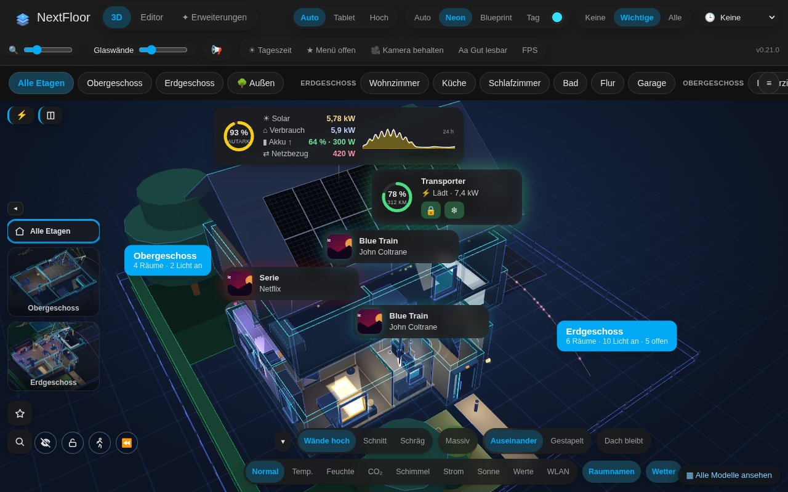
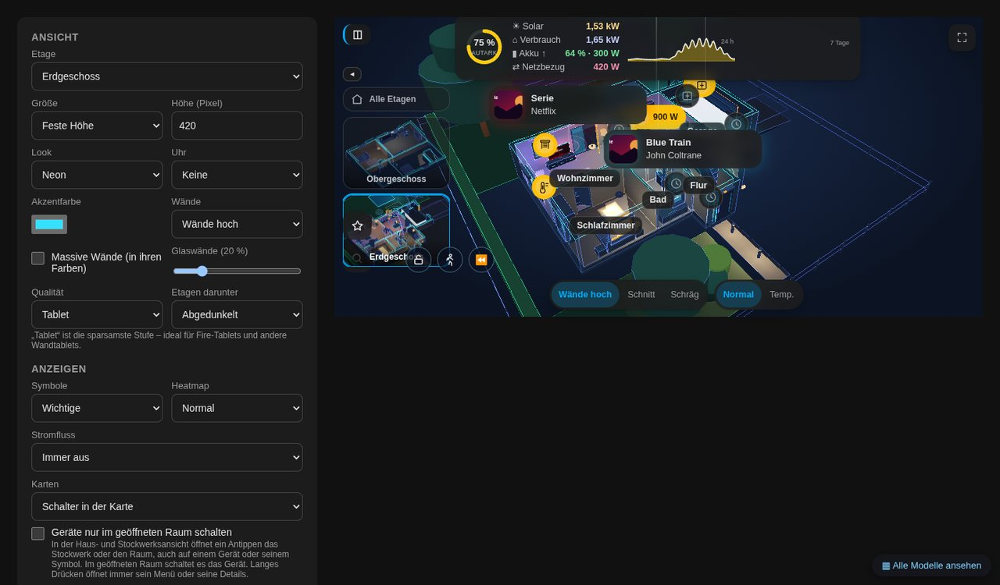

<p align="center"></p>

<h1 align="center">NextFloor</h1>

<p align="center"><b>Draw your home once. Watch it live in 3D.</b><br>
Lamps light their room, blinds move, doors open, the TV shows what plays, rain falls outside.<br>
A free 3D floor plan for Home Assistant. No cloud, no account. Made for wall tablets.</p>

<p align="center">
<a href="https://my.home-assistant.io/redirect/hacs_repository/?owner=therealMRBK&repository=NextFloor&category=integration"></a>
<a href="https://therealmrbk.github.io/NextFloor/docs/en/"></a>
<a href="https://therealmrbk.github.io/NextFloor/"></a>
<a href="https://therealmrbk.github.io/NextFloor/preview/index.html?showcase&lang=en"></a>
</p>

<p align="center">
<a href="https://github.com/therealMRBK/NextFloor/releases"></a>
<a href="https://github.com/therealMRBK/NextFloor/actions"></a>
<a href="https://hacs.xyz"></a>
<a href="#-free-forever"></a>
<a href="https://github.com/therealMRBK/NextFloor/blob/main/LICENSE"></a>
<a href="#-made-with-ai"></a>
</p>

<p align="center"></p>

<p align="center">
<a href="https://therealmrbk.github.io/NextFloor/docs/en/"><b>📚 Documentation</b></a> ·
<a href="https://therealmrbk.github.io/NextFloor/docs/en/quickstart/">Quick start</a> ·
<a href="https://therealmrbk.github.io/NextFloor/docs/en/cards/">Card options</a> ·
<a href="https://therealmrbk.github.io/NextFloor/docs/en/plugins/">Plugins</a> ·
<a href="https://therealmrbk.github.io/NextFloor/docs/en/faq/">FAQ</a> ·
<a href="https://therealmrbk.github.io/NextFloor/docs/de/">Deutsch</a> ·
<a href="https://github.com/therealMRBK/NextFloor/blob/main/README.zh-CN.md">简体中文</a> ·
<a href="https://therealmrbk.github.io/NextFloor/tutorial/">🎬 Setup video</a> ·
<a href="https://github.com/therealMRBK/NextFloor/blob/main/ROADMAP.md">Roadmap</a>
</p>

---

## ✨ In one minute

|  |  |  |
|---|---|---|
| **✏️ Draw it** | **💡 Watch it live** | **🧩 Make it yours** |
| Floors, rooms, curved walls, doors, windows, stairs, roofs and gardens, with the 3D model growing beside the plan. Or import a room scan, a CAD drawing or a Sweet Home 3D plan. | Tap a lamp and the real light switches. Blinds travel, doors open, the TV shows the running app, solar power flows along your real cables, rain falls. | 43 free furniture packs with about 800 models, a furniture studio and a browser builder, a dashboard card with templates, and a reviewed plugin store. |

<p align="center"></p>

## 🖼️ What it looks like

<table>
<tr>
<td align="center" width="50%"><a href="https://therealmrbk.github.io/NextFloor/docs/en/draw/"></a><br><sub><b>The editor.</b> Draw while the house grows beside you.</sub></td>
<td align="center" width="50%"><a href="https://therealmrbk.github.io/NextFloor/docs/en/view3d/"></a><br><sub><b>A room.</b> Every device of the room in one panel.</sub></td>
</tr>
<tr>
<td align="center"><a href="https://therealmrbk.github.io/NextFloor/docs/en/climate-energy/"></a><br><sub><b>Energy.</b> Power flows along the cables you drew.</sub></td>
<td align="center"><a href="https://therealmrbk.github.io/NextFloor/docs/en/climate-energy/"></a><br><sub><b>Climate.</b> Temperature, humidity, CO₂, mould and sun by room.</sub></td>
</tr>
<tr>
<td align="center"><a href="https://therealmrbk.github.io/NextFloor/docs/en/live/"></a><br><sub><b>Weather.</b> Rain, snow, fog, lightning, sun and moon.</sub></td>
<td align="center"><a href="https://therealmrbk.github.io/NextFloor/docs/en/furnish/"></a><br><sub><b>Furniture.</b> About 800 models, and your own.</sub></td>
</tr>
<tr>
<td align="center"><a href="https://therealmrbk.github.io/NextFloor/docs/en/tablet/"></a><br><sub><b>The wall tablet.</b> Kiosk mode, night dimming, announcements.</sub></td>
<td align="center"><a href="https://therealmrbk.github.io/NextFloor/docs/en/cards/"></a><br><sub><b>The card.</b> On any dashboard, with a visual editor.</sub></td>
</tr>
</table>

Looks: <a href="https://raw.githubusercontent.com/therealMRBK/NextFloor/main/docs/images/view-blueprint.jpg"><b>Blueprint</b></a> · <a href="https://raw.githubusercontent.com/therealMRBK/NextFloor/main/docs/images/view-day.jpg"><b>Day</b></a> · <a href="https://raw.githubusercontent.com/therealMRBK/NextFloor/main/docs/images/view-cut.jpg"><b>Cut-away walls</b></a> · <a href="https://raw.githubusercontent.com/therealMRBK/NextFloor/main/docs/images/view-stacked.jpg"><b>Stacked floors</b></a> · <a href="https://raw.githubusercontent.com/therealMRBK/NextFloor/main/docs/images/vehicles-tesla.jpg"><b>Vehicles</b></a> · <a href="https://raw.githubusercontent.com/therealMRBK/NextFloor/main/docs/images/furniture-ikea.jpg"><b>IKEA sizes</b></a>

## 🚀 Install in two minutes

NextFloor is in the **official HACS store**.

1. Open **HACS**, search for **NextFloor** and press **Download** (or use the HACS button above).
2. **Restart Home Assistant.**
3. Add the integration: [](https://my.home-assistant.io/redirect/config_flow_start/?domain=nextfloor), or *Settings → Devices & services → Add integration → NextFloor*.
4. Open **NextFloor** in the sidebar, switch to **Editor** and draw your first floor. The [quick start](https://therealmrbk.github.io/NextFloor/docs/en/quickstart/) takes you through the first room and lamp.

**Manual install:** copy `custom_components/nextfloor` into `config/custom_components/` and restart. Needs Home Assistant 2025.1 or newer. **Installed earlier as a custom repository?** Nothing to change: your plan and settings stay, and updates keep coming through HACS. More in the [installation guide](https://therealmrbk.github.io/NextFloor/docs/en/install/).

## 🧭 What it does

<details open>
<summary><b>Draw and plan</b></summary>

- **Plan editor:** floors, rooms, curved and sloping walls, doors, windows, shaped stairs, outdoor areas with fences and gates, roofs with overhang per side. Rooms open to the floor above, turned roof sections, wall thickness per part.
- **Import:** iPhone room scans (Apple RoomPlan), Sweet Home 3D, DXF and IFC, or a plan an AI draws from a picture of your floor plan.
- **Plan check:** one list of what is missing or off, with a fix in one tap, including standby eaters and their yearly cost.
- **Areas and paper:** living area per room, floor and house, counted like the German *Wohnflächenverordnung*; the plan at 1:100 to print or save as PDF.
- **Versions and notes:** named states of the plan ("before the renovation"), compared with the plan now; notes pinned to a spot, with a due day.
- **3D print:** save the house as an STL file at 1:100.

→ [Draw the house](https://therealmrbk.github.io/NextFloor/docs/en/draw/) · [Plan tools](https://therealmrbk.github.io/NextFloor/docs/en/plan-tools/)
</details>

<details open>
<summary><b>Furnish and connect</b></summary>

- **Furniture:** 40 basic models and 43 packs with about 800 more: season and decoration, wellness, music, loft, Japandi, workshop, vehicles, picture frames with your own photos, L- and U-sofas, IKEA sizes.
- **Build your own:** the furniture studio in the editor, and the [browser builder](https://therealmrbk.github.io/NextFloor/builder/) that shares to a community store.
- **Devices:** lamps with several bulbs, light programs, blinds (roller, venetian, inside, Somfy *My*), smart locks, gates, TVs with ambilight, speakers, a 3D printer, a heat pump, the car, pets, robot vacuums and mowers.
- **People:** a room sensor or a default room per person, shown in their rooms and counted per floor.

→ [Furnish](https://therealmrbk.github.io/NextFloor/docs/en/furnish/) · [Connect devices](https://therealmrbk.github.io/NextFloor/docs/en/devices/) · [Furniture packs](https://therealmrbk.github.io/NextFloor/docs/en/packs/)
</details>

<details open>
<summary><b>Live in 3D</b></summary>

- **Control:** tap to switch, swipe to dim, long press for colours, a room panel with scenes and moods, a central menu, search.
- **Weather and sun:** rain, snow, hail, fog, lightning, sun and moon, real shadows, a time-of-day slider, the sun's arc over the property.
- **Walk and time travel:** walk through the house at eye level, or replay the last day or week.
- **Warnings:** smoke, gas, water, the alarm with the sensor that set it off, windows open in the rain, and your own warnings.
- **Announcements:** *"Dinner is ready!"* in the room that should hear it, through its speaker and on every open screen.

→ [The 3D view](https://therealmrbk.github.io/NextFloor/docs/en/view3d/) · [Live features](https://therealmrbk.github.io/NextFloor/docs/en/live/) · [Announcements](https://therealmrbk.github.io/NextFloor/docs/en/announcements/)
</details>

<details open>
<summary><b>Climate, sun and energy</b></summary>

- **Heat maps:** temperature (summer and winter scale), humidity, CO₂, mould risk and a comfort score, Wi-Fi reach, hours of sun and power draw per room.
- **Room hints:** airing, low batteries, lights left on in empty rooms, shade when the sun heats a room, a window open while the heating runs.
- **Energy:** solar fields (also east-west racks), power flow along real cable routes, battery charge, gas and water meters, a meter per floor, the last 24 hours and seven days.

→ [Climate and energy](https://therealmrbk.github.io/NextFloor/docs/en/climate-energy/) · [Outside, roof and energy](https://therealmrbk.github.io/NextFloor/docs/en/outside/)
</details>

<details open>
<summary><b>Dashboard, tablet and automations</b></summary>

- **The card:** `custom:nextfloor-card` with a visual editor, card templates, a card for chosen rooms, floor-plan-only mode.
- **Wall tablet:** kiosk mode with night dimming, an easy-to-read mode, and quality that steps down by itself on slow tablets.
- **Automations:** *Open windows and doors* and *Lights on* as sensors for the house and every floor, plus the actions `nextfloor.announce` and `nextfloor.reload_screens`.
- **Look:** colours, font and corner radius from your Home Assistant theme; looks *Neon*, *Blueprint*, *Day* and *Own* (your own colours). Twenty languages.

→ [The dashboard card](https://therealmrbk.github.io/NextFloor/docs/en/cards/) · [Wall tablet](https://therealmrbk.github.io/NextFloor/docs/en/tablet/) · [Services and sensors](https://therealmrbk.github.io/NextFloor/docs/en/automations/)
</details>

## 🧩 The dashboard card

```yaml
type: custom:nextfloor-card
floor: ground       # optional: start floor
theme: neon         # neon | blueprint | day | own (colours: own_look)
room_buttons: true  # a row of room buttons
template: kitchen   # optional: a card template set up once in the editor
```

The visual editor sets every option without YAML. The [complete list of card options](https://therealmrbk.github.io/NextFloor/docs/en/cards/) has them all, with their defaults.

## 📚 Documentation

The full documentation is at **[therealmrbk.github.io/NextFloor/docs](https://therealmrbk.github.io/NextFloor/docs/en/)**: search, a dark and a light look, and every page in English and German.

| I want to … | Read |
|---|---|
| install and draw my first room | [Install](https://therealmrbk.github.io/NextFloor/docs/en/install/) · [Quick start](https://therealmrbk.github.io/NextFloor/docs/en/quickstart/) · [How it works](https://therealmrbk.github.io/NextFloor/docs/en/concepts/) |
| draw the house, furnish it, connect devices | [Draw](https://therealmrbk.github.io/NextFloor/docs/en/draw/) · [Furnish](https://therealmrbk.github.io/NextFloor/docs/en/furnish/) · [Connect devices](https://therealmrbk.github.io/NextFloor/docs/en/devices/) |
| use weather, energy, climate and announcements | [The 3D view](https://therealmrbk.github.io/NextFloor/docs/en/view3d/) · [Live features](https://therealmrbk.github.io/NextFloor/docs/en/live/) · [Climate and energy](https://therealmrbk.github.io/NextFloor/docs/en/climate-energy/) |
| put it on a dashboard or a wall tablet | [The dashboard card](https://therealmrbk.github.io/NextFloor/docs/en/cards/) · [Wall tablet](https://therealmrbk.github.io/NextFloor/docs/en/tablet/) |
| automate, extend, build my own | [Services and sensors](https://therealmrbk.github.io/NextFloor/docs/en/automations/) · [Plugins](https://therealmrbk.github.io/NextFloor/docs/en/plugins/) · [Furniture packs](https://therealmrbk.github.io/NextFloor/docs/en/packs/) · [Plan format](https://therealmrbk.github.io/NextFloor/docs/en/plan-format/) |
| fix something | [FAQ and troubleshooting](https://therealmrbk.github.io/NextFloor/docs/en/faq/) |

The Markdown sources are in [`docs/content`](https://github.com/therealMRBK/NextFloor/tree/main/docs/content). A pull request that improves a page is welcome.

## 💚 Free forever

NextFloor is free, and it stays free: not "free to try", not "free with a paid Pro", not "free until the next version". **Free, for everyone, forever.**

- **Nothing to buy, ever.** No Pro version, no paid modules, no packs sold one by one, no supporter pass, no licence key, no shop. The weather, the energy flow, TV screens, the car, announcements, the heat pump and the 3D printer are simply part of NextFloor.
- **New furniture all the time, for free.** 43 packs with about 800 models come with it, and new packs keep coming.
- **Build and extend it yourself.** The [furniture builder](https://therealmrbk.github.io/NextFloor/builder/) shares to a community store; a [plugin system](https://therealmrbk.github.io/NextFloor/docs/en/plugins/) with a reviewed [plugin store](https://github.com/therealMRBK/NextFloor-Plugins) adds device kinds, light animations and room cards, from anyone.
- **Your data stays home.** No account, no cloud, no usage data.
- **The promise is in the licence.** NextFloor is MIT licensed: anyone may read, change and share it. Nobody can take it away from you, not even me.

I believe in open source: software that anyone may read, change and share, and that every home can use without paying a cent. That conviction is the reason NextFloor exists.

## 🔒 Privacy

The plan, its pictures and the packs live in Home Assistant's `.storage`. NextFloor does not talk to the internet on its own. Only if you switch on the optional real map, your browser loads map tiles from the tile server (OpenStreetMap by default). Pictures and history come from your own Home Assistant.

## 🤖 Made with AI

NextFloor was built entirely with AI assistance. The idea, the decisions and the testing in a real house come from a person; the design, the code, the tests and the documentation were written together with [Claude](https://www.anthropic.com/claude) (Anthropic) in [Claude Code](https://www.anthropic.com/claude-code). I would rather say so openly than let you guess.

What that means for you:

- **It is tested, but young.** There are automated tests (frontend logic, the furniture packs, the Home Assistant side) and releases are looked at in a real browser and installed on a real Home Assistant, but it has far fewer users than most integrations. Expect rough edges and report them.
- **Back up before you trust it.** The plan lives in Home Assistant's `.storage`; the editor has a backup and restore of the whole plan.
- **Read the code if it matters to you.** It is MIT licensed and small enough to read. Pull requests are welcome, also ones written with AI, as long as you say so and have run the checks (see [CONTRIBUTING.md](https://github.com/therealMRBK/NextFloor/blob/main/CONTRIBUTING.md)).

## 💬 Ideas, questions and bugs

[Discussions](https://github.com/therealMRBK/NextFloor/discussions) for ideas and questions, [Issues](https://github.com/therealMRBK/NextFloor/issues/new/choose) for bugs. Security problems go through [private reporting](https://github.com/therealMRBK/NextFloor/security/advisories/new).

## 🛠️ Development

<details>
<summary>Build, test, preview</summary>

```bash
cd frontend
npm install
npm test            # pure logic
npm run typecheck
npm run build       # writes the bundles to custom_components/nextfloor/frontend (committed)
npm run screenshot  # renders preview/index.html (invented demo data) with a local Chrome or Chromium
```

- **Preview without Home Assistant:** open `preview/index.html` through any local web server.
- **Deploy to a test instance:** create `deploy.local.json` with `{"target": "<config>/custom_components/nextfloor"}` and run `npm run deploy` in `frontend/`.
- **Python tests** run in CI with `pytest-homeassistant-custom-component`.
- **Documentation site:** `cd tools/docs && npm install && npm run build` (sources in `docs/content`, English and German).
- **Furniture packs:** the built-in packs are generated by `tools/build_packs.py`. The format of your own packs is in the [documentation](https://therealmrbk.github.io/NextFloor/docs/en/packs/).

</details>

## 🙏 Credits

NextFloor started as a fork of [NeonPlan 3D](https://github.com/Mastershort/neonplan3d) by Mastershort (Torsten). The idea of a live 3D home right inside Home Assistant, and the groundwork NextFloor grew from, are his. NextFloor carries that idea on in its own direction: entirely free and open source, for everyone. Thank you, Torsten!

## Licence

MIT, see [LICENSE](https://github.com/therealMRBK/NextFloor/blob/main/LICENSE). NextFloor ships [three.js](https://threejs.org) (MIT), [Lit](https://lit.dev) (BSD-3-Clause); their notices are in [THIRD_PARTY_NOTICES.md](https://github.com/therealMRBK/NextFloor/blob/main/THIRD_PARTY_NOTICES.md).

"Home Assistant" is a trademark of its owners; "Tesla" and the Tesla model names are trademarks of Tesla, Inc., and "IKEA" and its product names are trademarks of Inter IKEA Systems B.V.; they are used here only to name the sizes and models. NextFloor is an independent community project and not affiliated with or endorsed by Nabu Casa, Tesla or IKEA.
