<p align="center">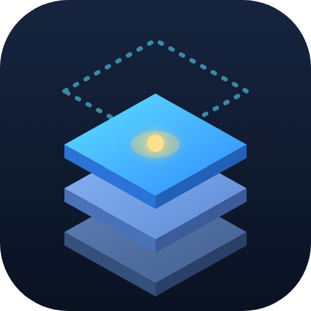</p>

<h1 align="center">NextFloor</h1>

<p align="center"><b>Draw your home inside Home Assistant and watch it live in 3D.</b><br>
Lamps light their room, blinds move, doors open, the TV shows what plays, rain falls outside.<br>
No cloud, no account. Made for wall tablets.</p>

<p align="center"><b>💚 Free forever. Every feature, every furniture pack, every update – for everyone, and it stays that way.</b><br>
No Pro version, no paid add-ons, no supporter pass, no licence key, no shop.</p>

<p align="center">
<a href="https://my.home-assistant.io/redirect/hacs_repository/?owner=therealMRBK&repository=NextFloor&category=integration"></a>
<a href="https://therealmrbk.github.io/NextFloor/"></a>
<a href="https://therealmrbk.github.io/NextFloor/preview/index.html?showcase&lang=en"></a>
<a href="https://therealmrbk.github.io/NextFloor/dev/"></a>
</p>

<p align="center">
<a href="https://github.com/therealMRBK/NextFloor/releases"></a>
<a href="https://github.com/therealMRBK/NextFloor/actions"></a>
<a href="https://hacs.xyz"></a>
<a href="#-free-forever--a-promise"></a>
<a href="https://github.com/therealMRBK/NextFloor/blob/main/LICENSE"></a>
<a href="#made-with-ai"></a>
</p>

<p align="center">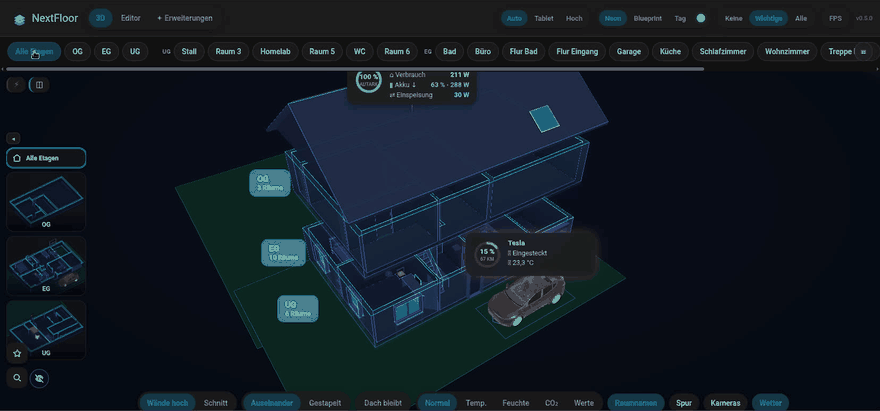</p>

<p align="center">🎬 <a href="https://therealmrbk.github.io/NextFloor/tutorial/">Watch the setup video in your browser, from the empty page (45 min, English voice, subtitles en/de)</a></p>

<p align="center">📖 <a href="https://github.com/therealMRBK/NextFloor/blob/main/docs/manual.md">Manual</a> · <a href="https://github.com/therealMRBK/NextFloor/blob/main/docs/anleitung.md">Anleitung (Deutsch)</a> · 🗺️ <a href="https://github.com/therealMRBK/NextFloor/blob/main/ROADMAP.md">Roadmap</a> · 📝 <a href="https://github.com/therealMRBK/NextFloor/blob/main/CHANGELOG.md">Changelog</a></p>

---

## ✨ What it does

| | |
|---|---|
| ✏️ **Plan editor** | Floors, rooms, curved walls, doors, windows, shaped stairs, outdoor areas and roofs, drawn in Home Assistant with the 3D view beside the plan. Areas within a room, layers, inside sizes, wall thickness per part, **rooms open to the floor above**, turned roof sections, DXF import. |
| ✓ **Plan check** | One list of what is missing or off – rooms without an area, devices not placed, overlapping rooms, doors off their wall, links to entities that are gone – standby eaters with their yearly cost – each with a fix in one tap. A short tour for a new plan and the sheet of keys (press `?`). |
| 📐 **Areas & paper** | Living area per room, floor and house, counted like the German Wohnflächenverordnung; **the plan on paper** at 1:100 with measurements and a table of areas, to print or save as PDF. |
| 🕘 **Versions & notes** | Named states of the plan ("before the renovation") that stay, compared with the plan now; **notes pinned to a spot**, with a due day, as pins in 3D and found by the search. |
| 💡 **Live 3D** | Tap to switch, swipe to dim, long press for colours. Lamps with several bulbs, blinds (roller, venetian slats, inside blinds, Somfy *My*), windows and doors follow their entities; a room panel lists everything in the room, scenes first. |
| ✨ **Light designer** | Save a room's lights as a mood, set it again with one tap, carry it over to another room. |
| 🌡️ **Room climate** | Heat maps for temperature (summer and winter scale), humidity, CO₂, **mould risk** and a **comfort score**, airing hints, low batteries, lights left on in empty rooms, each room's 24-hour temperature curve, underfloor heating that glows. |
| ☀️ **Sun & power per room** | Heat maps for the **hours of sun** each room gets today through its windows (from the plan, its compass and the sun's path) and for **what each room draws now**; in the room panel also today's and this month's kWh and cost, the sun over the year, a **shade hint** when the sun heats a room and a hint when a window stands open while the heating runs. |
| ⚡ **Energy** | Solar fields (also east-west racks), power flow along real cable routes, battery charge on the unit, gas and water meters, a meter per floor, the last 24 hours and **seven days** on the house card. |
| 🤖 **Sensors for automations** | *Open windows and doors* and *Lights on* as Home Assistant sensors, for the house and every floor, with the entities in their attributes. **Everything off** per room or floor, with undo. |
| 🔥 **Heat pump & 🖨️ 3D printer** | Live cards: flow and return, heat and COP; print progress, time left, layer, temperatures and filaments – the print grows on the bed. |
| 🚗 **Car** | Charge, range, charging along its cable from the wallbox, departure time, distance away, open doors and hatches, lock and climate buttons. |
| 📶 **Wi-Fi map** | Every access point's reach on the floor, its devices, and which network devices are offline. |
| 📅 **Today** | The day's appointments and the bins due, on a card for the wall tablet. |
| ⚠️ **Warnings** | Smoke, gas, water, the alarm with the sensor that set it off, windows open in the rain, contacts that stop answering – and **your own warnings** for any entity. |
| 📢 **Announcements** | *"Dinner is ready!"* in the room that should hear it, through its speaker and on every open NextFloor screen. |
| 🏡 **Household & garden** | Waste bins, mailbox, thirsty plants, pets that roam the room they really are in, robot vacuums and **robot mowers** on their lanes, sprinklers, pools with temperature and pump, gardens linked to their Home Assistant area, *🧹 Clean* per room, the fuse box's circuits per room. |
| 📺 **Media** | TV screens with cover and ambilight; a quick menu for every speaker and TV with sources, volume and presets per speaker. |
| 🛋️ **Furniture** | 40 basic models and **40 packs with almost 800 more** – season and decoration, wellness, music, loft, Japandi, workshop, vehicles, **picture frames with your own photos** – L- and U-sofas, IKEA sizes, Tesla models in their paint. Any piece can show only while a helper is on. |
| 🚶 **Walk and time travel** | Walk through the house at eye level; replay the last hours or days. |
| 🖥️ **Wall tablet ready** | Kiosk mode with night dimming, the star menu open and large, zoom and a kept camera for small screens, **quality that steps down by itself** on slow tablets, an **easy-to-read** mode with stronger contrast and larger text. |
| 🎨 **Fits your theme** | Colours, font and corner radius from Home Assistant; looks *Neon*, *Blueprint*, *Day*, solid painted walls. |
| 🧩 **Card, plugins, languages** | `custom:nextfloor-card` with a visual editor, a plugin system with its own store, and nine languages. |
| 🪑 **Build your own** | The **🛠️ furniture studio right in the editor** (cabinets with doors and drawers, shelves, lamps, devices with a display), the [furniture builder](https://therealmrbk.github.io/NextFloor/builder/) and a community store, own `.glb` models, Sweet Home 3D and DXF import, a plan format an AI can write – and **share a view** of your house as a file that opens in any browser. |

<p align="center">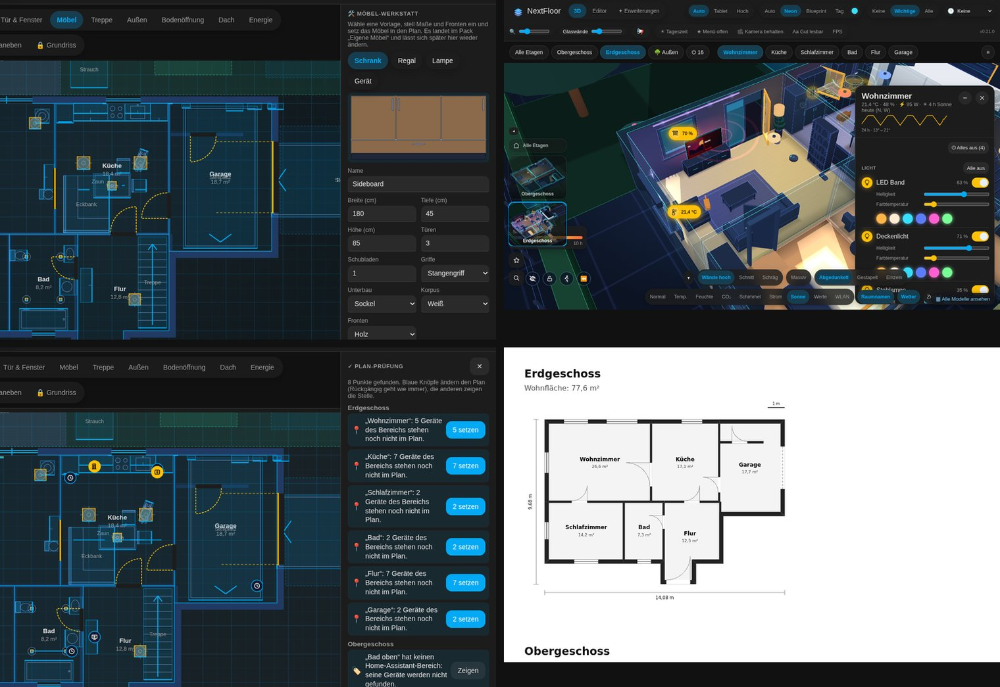</p>

<p align="center">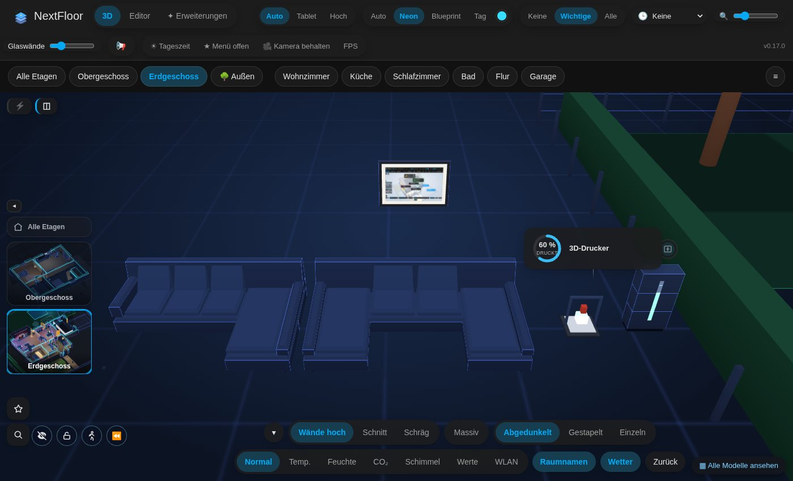</p>

## 💚 Free forever – a promise

NextFloor is free, and it stays free. Not "free to try", not "free with a paid Pro", not "free until the next version": **free, for everyone, forever.** Every feature, every furniture pack and every update belongs to everyone the day it comes out.

- **Nothing to buy, ever.** No Pro version, no paid modules, no packs sold one by one, no supporter pass that gets features first, no licence key, no shop. Everything – the weather outside, the energy flow, TV screens and speakers, the car, announcements, household and garden, the heat pump and the 3D printer – is simply part of NextFloor.
- **New furniture all the time, for free.** 40 packs with almost 800 models come with it, and new packs keep coming with the updates.
- **Build your own furniture.** The [furniture builder](https://therealmrbk.github.io/NextFloor/builder/) runs in your browser: build it, see it exactly as NextFloor draws it, and share it in the community store, where everyone installs it with one tap.
- **Extend it yourself.** A [plugin system](https://github.com/therealMRBK/NextFloor/blob/main/docs/plugins.md) with a reviewed [plugin store](https://github.com/therealMRBK/NextFloor-Plugins): new device kinds, light animations, room cards – from anyone.
- **Your data stays home.** No account, no cloud, no usage data sent anywhere.
- **The promise is in the licence.** NextFloor is MIT licensed: anyone may read, change and share it. Nobody can ever take it away from you – not even me.

I believe in open source: software that anyone may read, change and share, and that every home can use without paying a cent. That conviction is the reason NextFloor exists. It began as a fork of NeonPlan 3D and went its own way, carried by this one promise and shaped together by the people who use it.

## 🖼️ Gallery

<table>
<tr><td align="center" width="33%"><a href="https://raw.githubusercontent.com/therealMRBK/NextFloor/main/docs/images/view-room.jpg">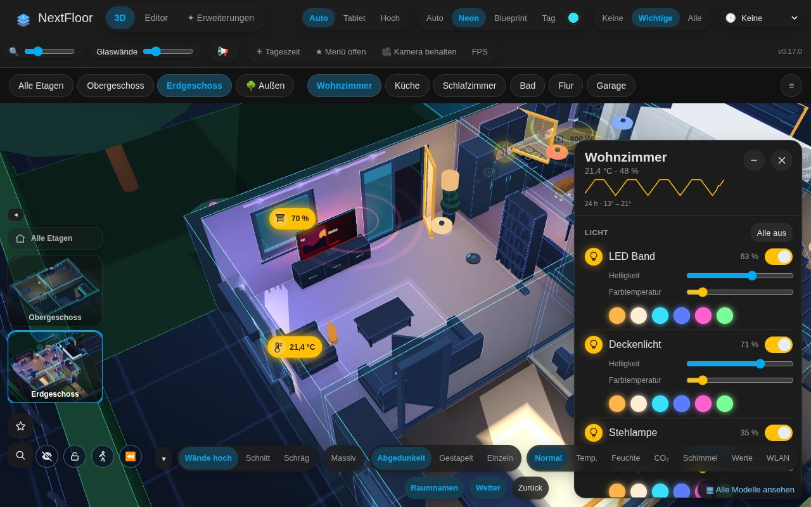</a><br><sub>Live room view with its panel</sub></td><td align="center" width="33%"><a href="https://raw.githubusercontent.com/therealMRBK/NextFloor/main/docs/images/editor.jpg">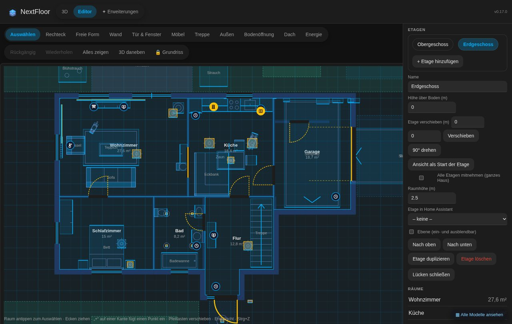</a><br><sub>Plan editor with 3D beside it</sub></td><td align="center" width="33%"><a href="https://raw.githubusercontent.com/therealMRBK/NextFloor/main/docs/images/view-stacked.jpg">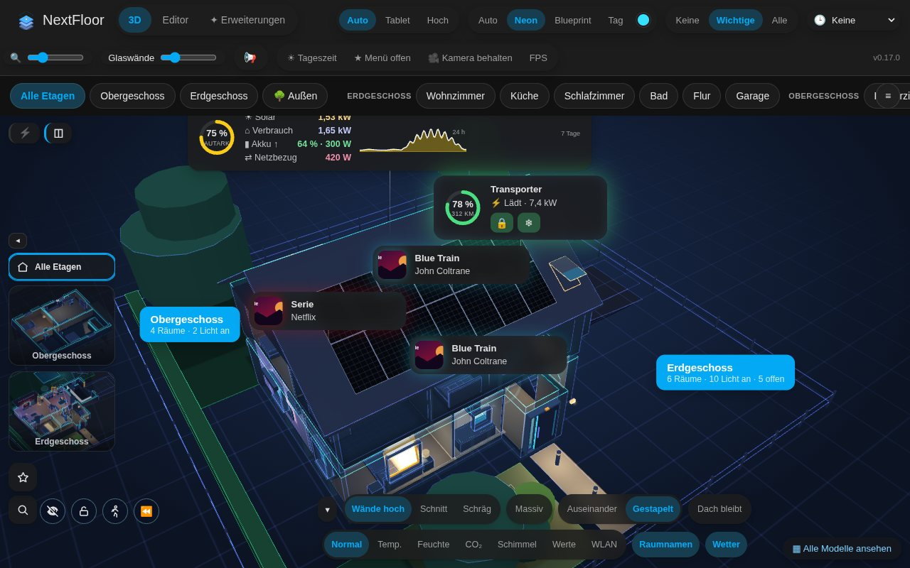</a><br><sub>Floors stacked</sub></td></tr>
<tr><td align="center" width="33%"><a href="https://raw.githubusercontent.com/therealMRBK/NextFloor/main/docs/images/view-energy.jpg">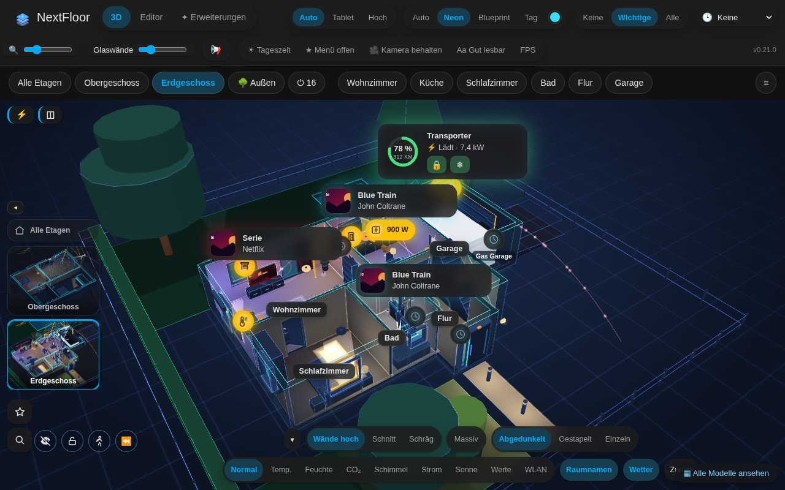</a><br><sub>Energy flow</sub></td><td align="center" width="33%"><a href="https://raw.githubusercontent.com/therealMRBK/NextFloor/main/docs/images/view-weather-rain.jpg">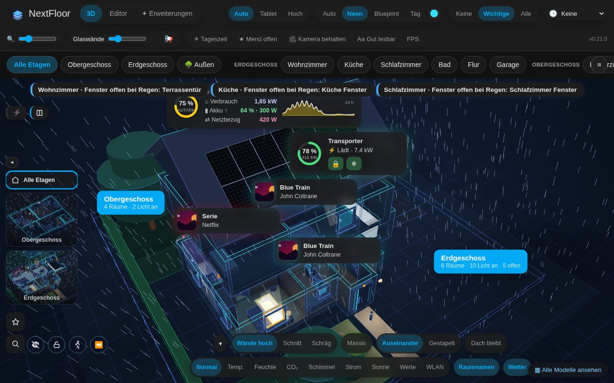</a><br><sub>Weather outside</sub></td><td align="center" width="33%"><a href="https://raw.githubusercontent.com/therealMRBK/NextFloor/main/docs/images/view-media.jpg">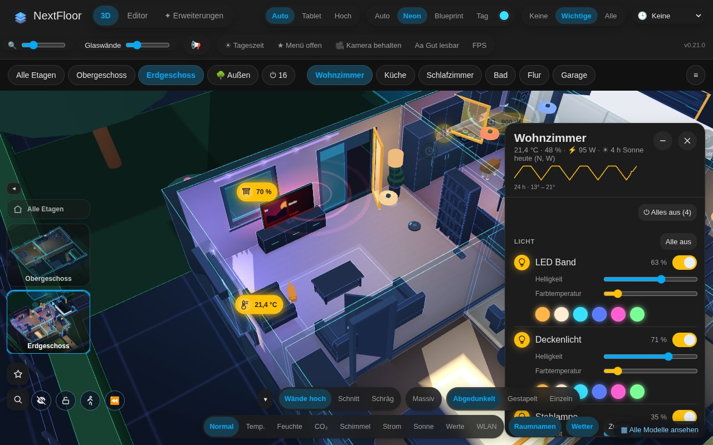</a><br><sub>TV screens</sub></td></tr>
<tr><td align="center" width="33%"><a href="https://raw.githubusercontent.com/therealMRBK/NextFloor/main/docs/images/view-heat.jpg">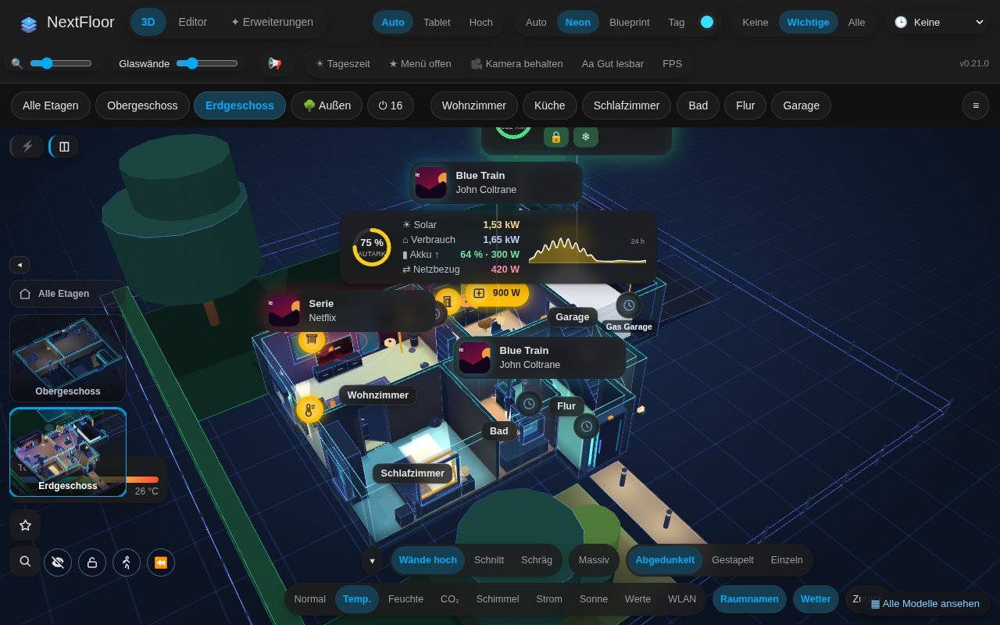</a><br><sub>Heat map</sub></td><td align="center" width="33%"><a href="https://raw.githubusercontent.com/therealMRBK/NextFloor/main/docs/images/view-cut.jpg">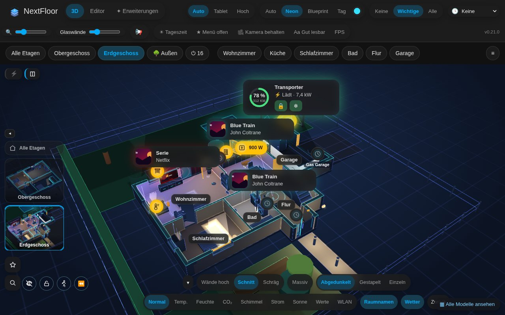</a><br><sub>Cut-away walls</sub></td><td align="center" width="33%"><a href="https://raw.githubusercontent.com/therealMRBK/NextFloor/main/docs/images/tablet.jpg">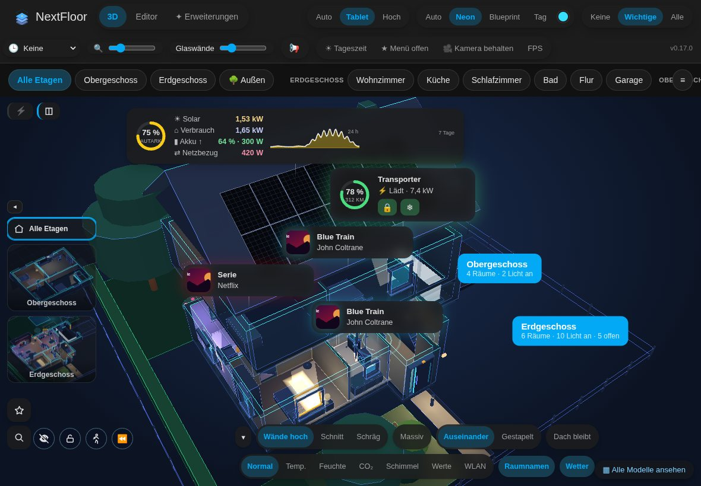</a><br><sub>Wall tablet</sub></td></tr>
<tr><td align="center" width="33%"><a href="https://raw.githubusercontent.com/therealMRBK/NextFloor/main/docs/images/editor-furniture.jpg">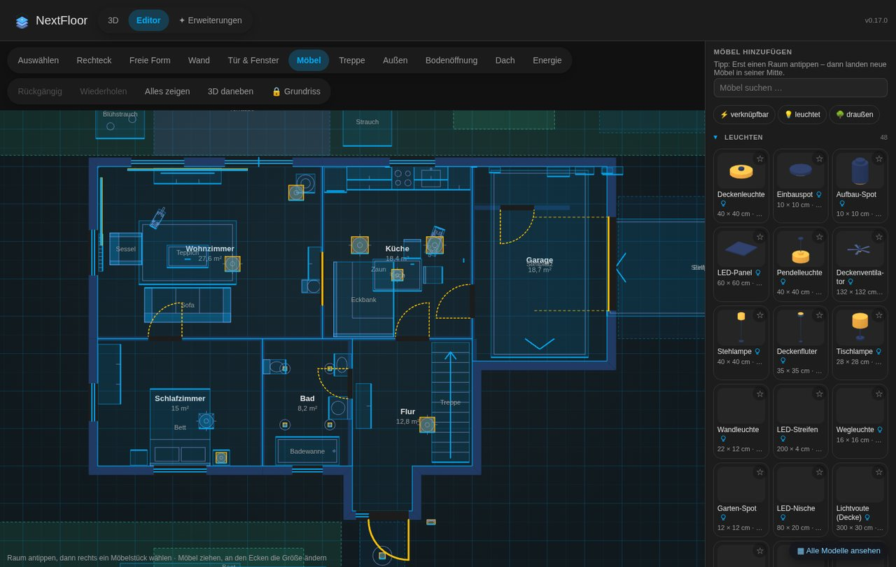</a><br><sub>Furniture library</sub></td><td align="center" width="33%"><a href="https://raw.githubusercontent.com/therealMRBK/NextFloor/main/docs/images/furniture-ikea.jpg">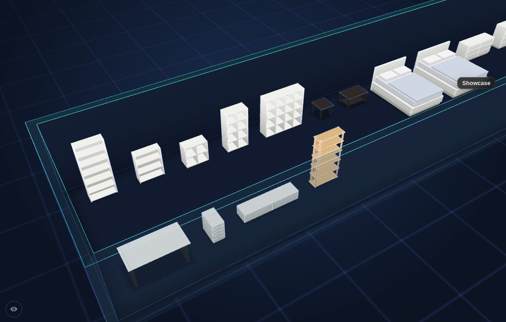</a><br><sub>IKEA sizes</sub></td><td align="center" width="33%"><a href="https://raw.githubusercontent.com/therealMRBK/NextFloor/main/docs/images/vehicles-tesla.jpg">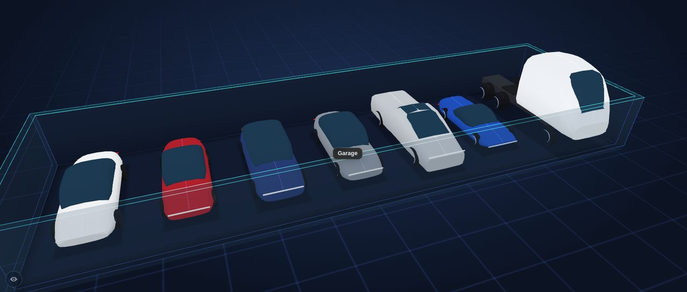</a><br><sub>Tesla models</sub></td></tr>
</table>

<table>
<tr><td align="center" width="33%"><a href="https://raw.githubusercontent.com/therealMRBK/NextFloor/main/docs/images/view-room.jpg"></a><br><sub>Neon</sub></td><td align="center" width="33%"><a href="https://raw.githubusercontent.com/therealMRBK/NextFloor/main/docs/images/view-blueprint.jpg">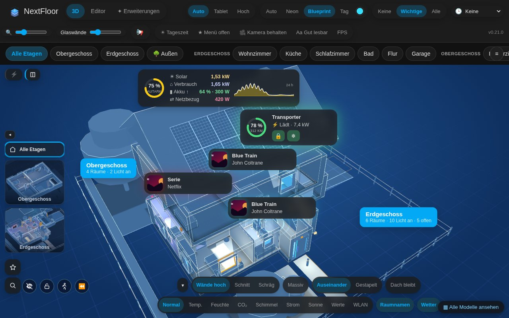</a><br><sub>Blueprint</sub></td><td align="center" width="33%"><a href="https://raw.githubusercontent.com/therealMRBK/NextFloor/main/docs/images/view-day.jpg">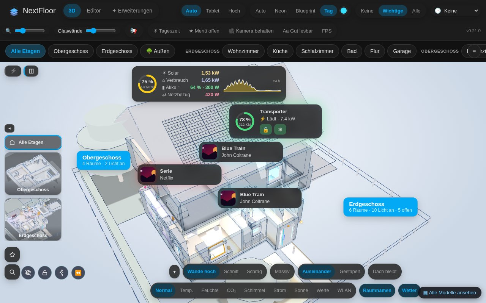</a><br><sub>Day</sub></td></tr>
</table>

## 🚀 Installation

**HACS** (recommended)

1. Click the HACS button above, or in HACS go to ⋮ → *Custom repositories* and add `https://github.com/therealMRBK/NextFloor` as **Integration**.
2. Install **NextFloor** and restart Home Assistant.
3. Add the integration: [](https://my.home-assistant.io/redirect/config_flow_start/?domain=nextfloor) or *Settings → Devices & services → Add integration → NextFloor*.
4. Open **NextFloor** in the sidebar, switch to **Editor** and draw your first floor.

**Manual:** copy `custom_components/nextfloor` into `config/custom_components/` and restart. Requires Home Assistant 2025.1 or newer.

## 🧩 Dashboard card

Every option is in the card's visual editor. The same in YAML:

<details>
<summary>All options</summary>

```yaml
type: custom:nextfloor-card
floor: floor_ab12cd34   # optional: show a single floor (id from the editor)
room: room_ab12cd34     # optional: start in this room
height: 420             # optional: height in pixels
fill: false             # optional: fill the screen below the dashboard header instead of a height
walls: auto             # optional: auto | cut
explode: true           # optional: pull floors apart in the house view
floor_stack: dim        # optional: floors below an opened floor: dim | stacked | single
quality: auto           # optional: auto | low | high
theme: neon             # optional: neon | blueprint | day
accent: "#00e5ff"       # optional: accent colour for the neon look
markers: important      # optional: none | important | all
heatmap: none           # optional: none | temperature | humidity | co2 | mould | values | wifi
room_panel: true        # optional: tapping a room opens its details
room_names: true        # optional: room names in 3D
controls: true          # optional: switches in the card, or a list of walls, floors, temperature, humidity, co2
floor_thumbs: true      # optional: floor pictures to switch floors
fullscreen_button: false
stats: false            # optional: performance display
alerts: true            # optional: smoke, gas, CO, water, alarm and windows open in the rain pulse
alert_jump: false       # optional: jump to the room of a new warning
scenes: true            # optional: scene and script buttons of the selected room
energy: true            # optional: energy values at the top
flows: true             # optional: power flow lines always on (true) or off (false); leave out for a switch
holograms: true         # optional: live cards (energy balance, car, media) always on or off; leave out for a switch
weather: true           # optional: weather outside
weather_entity: weather.home   # optional: which weather entity (default: as set in the plan)
idle_return: 0          # optional: kiosk, seconds without a touch until the start view returns
night: "off"            # optional: kiosk, dim at night: off | sun | "22:00-06:00"
idle_orbit: false       # optional: kiosk, slow camera turn after the idle return
central_open: false     # optional: the star menu (favourites) open from the start and a size larger
keep_camera: false      # optional: keep side, height and distance when switching floors
readable: false         # optional: stronger contrast and larger text (wall tablets)
zoom: 1                 # optional: 0.6 … 2.5, how close the fitted views come
today: true             # optional: the "Today" card with appointments and bins
sensor_bar: true        # optional: your own sensors at the top
```

</details>

## 📦 Your own 3D models

Own a model of a vehicle (`.glb`)? Open **Extensions** in the NextFloor panel, choose the file, turn the front towards you, pick the level of detail and store it on your Home Assistant. NextFloor does the preparation in the browser and ships no models. See [docs/models.md](https://github.com/therealMRBK/NextFloor/blob/main/docs/models.md).

## 🔒 Privacy

The plan, its pictures and the packs live in Home Assistant's `.storage`. NextFloor does not talk to the internet on its own; only if you switch on the optional real map, your browser loads map tiles from the tile server (OpenStreetMap by default). Pictures and history come from your own Home Assistant.

## 🤖 Made with AI

NextFloor was built entirely with AI assistance. The idea, the decisions and the testing in a real house come from a person; the design, the code, the tests and the documentation were written together with [Claude](https://www.anthropic.com/claude) (Anthropic) in [Claude Code](https://www.anthropic.com/claude-code). I would rather say so openly than let you guess.

What that means for you:

- **It is tested, but young.** There are automated tests (frontend logic, the furniture packs, the Home Assistant side) and releases are looked at in a real browser and installed on a real Home Assistant, but it has far fewer users than most integrations. Expect rough edges and report them.
- **Back up before you trust it.** The plan lives in Home Assistant's `.storage`; the editor has a backup and restore of the whole plan.
- **Read the code if it matters to you.** It is MIT licensed and small enough to read. Pull requests are welcome, also ones written with AI, as long as you say so and have run the checks (see [CONTRIBUTING.md](https://github.com/therealMRBK/NextFloor/blob/main/CONTRIBUTING.md)).

## 🛠️ Development

<details>
<summary>Build, test, preview</summary>

```bash
cd frontend
npm install
npm test            # pure logic
npm run typecheck
npm run build       # writes the bundles to custom_components/nextfloor/frontend (committed)
npm run screenshot  # renders preview/index.html (invented demo data) with a local Chrome or Chromium
```


- **Preview without Home Assistant**: open `preview/index.html` through any local web server.
- **Deploy to a test instance**: create `deploy.local.json` with `{"target": "<config>/custom_components/nextfloor"}` and run `npm run deploy` in `frontend/`.
- **Python tests** run in CI with `pytest-homeassistant-custom-component`.
- **Furniture packs**: the built-in packs are generated by `tools/build_packs.py`. The format of your own packs is described in [docs/packs.md](https://github.com/therealMRBK/NextFloor/blob/main/docs/packs.md) (German).

</details>

## 💬 Ideas, questions and bugs

[Discussions](https://github.com/therealMRBK/NextFloor/discussions) for ideas and questions, [Issues](https://github.com/therealMRBK/NextFloor/issues/new/choose) for bugs.

## 🙏 Credits

NextFloor started as a fork of [NeonPlan 3D](https://github.com/Mastershort/neonplan3d) by Mastershort (Torsten). The idea of a live 3D home right inside Home Assistant, and the groundwork NextFloor grew from, are his. NextFloor carries that idea on in its own direction: entirely free and open source, for everyone. Thank you, Torsten!

## Licence

MIT, see [LICENSE](https://github.com/therealMRBK/NextFloor/blob/main/LICENSE). NextFloor ships [three.js](https://threejs.org) (MIT), [Lit](https://lit.dev) (BSD-3-Clause); their notices are in [THIRD_PARTY_NOTICES.md](https://github.com/therealMRBK/NextFloor/blob/main/THIRD_PARTY_NOTICES.md).

"Home Assistant" is a trademark of its owners; "Tesla" and the Tesla model names are trademarks of Tesla, Inc., and "IKEA" and its product names are trademarks of Inter IKEA Systems B.V.; they are used here only to name the sizes and models. NextFloor is an independent community project and not affiliated with or endorsed by Nabu Casa, Tesla or IKEA.
