<p align="center">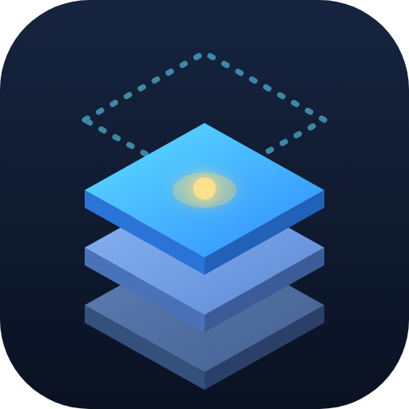</p>

<h1 align="center">NextFloor</h1>

<p align="center"><b>在 Home Assistant 里画出你的家，实时看它活起来。</b><br>
灯会照亮所在的房间，卷帘会动，门会开，电视播什么就显示什么，屋外在下雨。<br>
没有云端，不用账号。为墙上平板而生。</p>

<p align="center"><b>💚 永久免费。每一个功能、每一个家具包、每一次更新——所有人都能用，而且一直如此。</b><br>
没有 Pro 版，没有付费插件，没有赞助通行证，没有许可证密钥，没有商店。</p>

<p align="center">
<a href="https://my.home-assistant.io/redirect/hacs_repository/?owner=therealMRBK&repository=NextFloor&category=integration"></a>
<a href="https://therealmrbk.github.io/NextFloor/"></a>
<a href="https://therealmrbk.github.io/NextFloor/preview/index.html?showcase&lang=en"></a>
<a href="https://therealmrbk.github.io/NextFloor/dev/"></a>
</p>

<p align="center">
<a href="https://github.com/therealMRBK/NextFloor/releases"></a>
<a href="https://github.com/therealMRBK/NextFloor/actions"></a>
<a href="https://hacs.xyz"></a>
<a href="#-永久免费--一个承诺"></a>
<a href="https://github.com/therealMRBK/NextFloor/blob/main/LICENSE"></a>
<a href="#-由-ai-协助构建"></a>
</p>

<p align="center">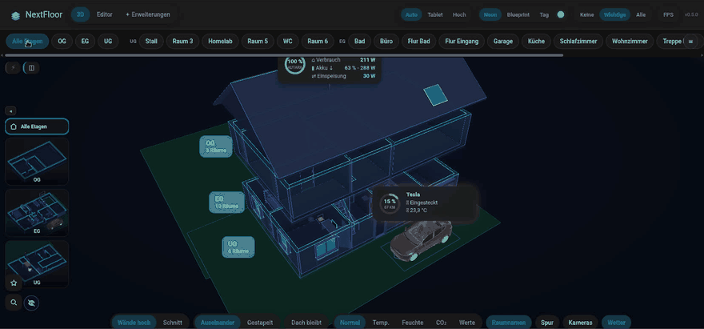</p>

<p align="center">📖 <a href="https://github.com/therealMRBK/NextFloor/blob/main/README.md">English</a> · <b>简体中文</b></p>

<p align="center">🎬 <a href="https://therealmrbk.github.io/NextFloor/tutorial/">在浏览器里看安装视频，从空白页面开始（45 分钟，英语配音，中/英/德字幕）</a></p>

<p align="center">📖 <a href="https://github.com/therealMRBK/NextFloor/blob/main/docs/manual.zh-CN.md">中文手册</a> · <a href="https://github.com/therealMRBK/NextFloor/blob/main/docs/manual.md">英文手册</a> · <a href="https://github.com/therealMRBK/NextFloor/blob/main/docs/anleitung.md">Anleitung（德语）</a> · 🗺️ <a href="https://github.com/therealMRBK/NextFloor/blob/main/ROADMAP.md">路线图</a> · 📝 <a href="https://github.com/therealMRBK/NextFloor/blob/main/CHANGELOG.md">更新日志</a></p>

---

## ✨ 它能做什么

| | |
|---|---|
| ✏️ **平面图编辑器** | 楼层、房间、弧形墙、门窗、异形楼梯、室外区域和屋顶，都在 Home Assistant 里绘制，3D 视图就在平面图旁边。房间内的分区、图层、内侧尺寸、分段墙厚、**通到上层的挑高房间**、可转向的屋顶段、DXF 导入。 |
| ✓ **平面图检查** | 一张清单列出缺什么、哪里不对——房间没有区域、设备没放进去、房间重叠、门窗不在墙上、关联的实体已不存在——还有待机耗电设备及其年度电费，每项都能一键修复。新平面图有简短引导，按 `?` 看快捷键表。 |
| 📐 **面积与图纸** | 每个房间、每个楼层、整栋房子的居住面积，按德国《居住面积条例》计算；**1:100 的纸质平面图**，带尺寸和面积表，可直接打印或存为 PDF。 |
| 🕘 **版本与便签** | 给平面图起名存档（比如"装修前"），会一直保留，可与当前平面图对比；**便签可以钉在某个位置**，带到期日，在 3D 里显示为标记，搜索也能找到。 |
| 💡 **实时 3D** | 点击开关、滑动调光、长按换色。多灯泡灯具、卷帘（卷帘、百叶、内遮阳、Somfy *My*）、门窗都跟随对应实体；房间面板列出房间里的一切，场景排在最前。 |
| ✨ **灯光设计器** | 把房间的灯存成一个氛围，一键重现，还能套用到另一个房间。 |
| 🌡️ **房间气候** | 温度（夏季/冬季色阶）、湿度、CO₂、**发霉风险**和**舒适度评分**的热图，通风提示、低电量、空房间里忘关的灯、每个房间 24 小时温度曲线、会发亮的地暖。 |
| ☀️ **每个房间的阳光与用电** | 热图显示每个房间今天透过窗户获得的**日照小时**（依据平面图、朝向和太阳轨迹）和**当前用电功率**；房间面板里还有今日与本月的 kWh 和费用、全年日照、阳光晒热房间时的**遮阳提示**，以及供暖时开窗的提示。 |
| ⚡ **能源** | 光伏板阵（含东西向支架）、沿真实线缆路径的功率流动、储能电池电量、燃气与水表、每层独立电表，房屋卡片上显示最近 24 小时和**最近七天**。 |
| 🤖 **给自动化用的传感器** | *开着的门窗*和*开着的灯*作为 Home Assistant 传感器，有全屋和每层两种，实体列在属性里。按房间或按楼层**一键全关**，可撤销。 |
| 🔥 **热泵与 🖨️ 3D 打印机** | 实时卡片：出水/回水温度、热量与 COP；打印进度、剩余时间、层数、温度与耗材——打印件会在热床上长出来。 |
| 🚗 **汽车** | 电量、续航、充电时电流沿充电线从充电桩流向车、出发时间、离家距离、开着的门和后备箱、门锁与空调按钮。 |
| 📶 **Wi-Fi 地图** | 每个接入点在本层的覆盖范围、它带的设备，以及哪些网络设备离线。 |
| 📅 **今日** | 当天的日程和要收的垃圾桶，做成墙上平板的一张卡片。 |
| ⚠️ **告警** | 烟雾、燃气、漏水、报警器（并指出是哪个传感器触发的）、下雨时开着的窗、失联的门磁——还能为任意实体做**你自己的告警**。 |
| 📢 **播报** | *"开饭了！"* 只传给该听到的房间，通过它的音箱播，也会显示在每个打开的 NextFloor 屏幕上。 |
| 🏡 **家务与庭院** | 垃圾桶、信箱、缺水的植物、只在真实所在房间走动的宠物、扫地机和**割草机器人**按路线工作、喷灌、带水温和水泵的泳池、关联到 Home Assistant 区域的花园、每个房间的 *🧹 清洁*、每个房间对应的配电箱回路。 |
| 📺 **媒体** | 电视屏幕带封面和氛围灯；每个音箱和电视都有快捷菜单，含输入源、音量和每个音箱的预设。 |
| 🛋️ **家具** | 40 个基础模型和**41 个家具包、近 800 件家具**——季节与装饰、卫浴、音乐、Loft、日式、工坊、车辆、**可放自己照片的相框**——L 形和 U 形沙发、宜家尺寸、按原厂漆色渲染的特斯拉车型。任何家具都能设为"仅当某个辅助实体开启时显示"。 |
| 🚶 **漫游与时光回溯** | 以视线高度在屋里走动；回放最近几小时或几天。 |
| 🖥️ **为墙上平板准备** | 展示模式支持夜间调暗、星标菜单常开且更大、小屏幕的缩放与固定视角、慢速平板上**画质自动降级**、对比度更高字号更大的**易读模式**。 |
| 🎨 **跟随你的主题** | 颜色、字体、圆角都取自 Home Assistant；外观有 *Neon*、*Blueprint*、*Day*，以及实心刷漆墙面。 |
| 🧩 **卡片、插件、多语言** | `custom:nextfloor-card` 带可视化编辑器，插件系统带自己的商店，支持九种语言（含**简体中文**）。 |
| 🪑 **自己动手做** | **编辑器里的 🛠️ 家具工作室**（带门和抽屉的柜子、搁架、灯具、带屏幕的设备）、[家具构建器](https://therealmrbk.github.io/NextFloor/builder/)和社区商店、自己的 `.glb` 模型、Sweet Home 3D 与 DXF 导入、可被 AI 直接编写的平面图格式——还能把房屋**分享成一个视图文件**，在任何浏览器里打开。 |

<p align="center">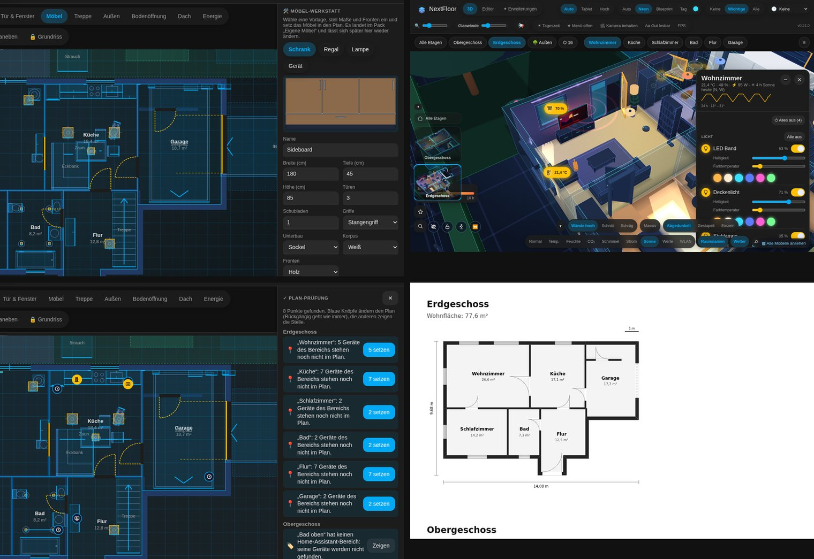</p>

<p align="center">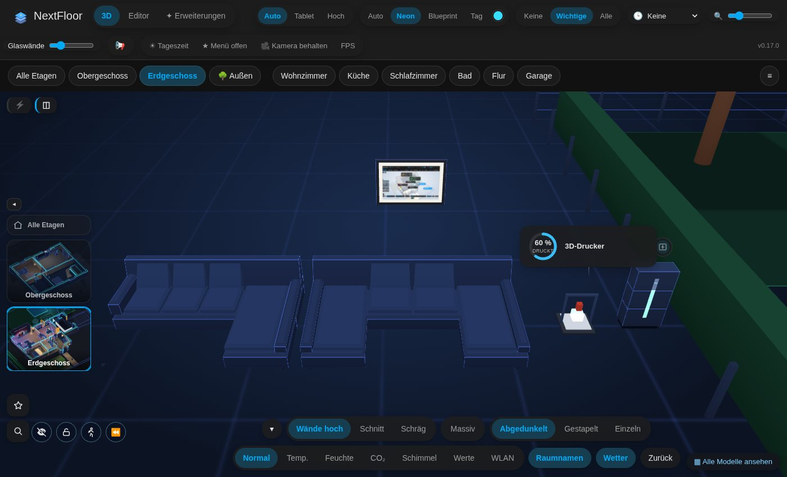</p>

## 💚 永久免费 —— 一个承诺

NextFloor 是免费的，而且会一直免费。不是"免费试用"，不是"免费但 Pro 要钱"，也不是"这一版免费"：**对所有人、永远免费。** 每一个功能、每一个家具包、每一次更新，发布当天就属于所有人。

- **没有任何要买的东西。** 没有 Pro 版，没有付费模块，没有逐个售卖的家具包，没有能优先拿到功能的赞助通行证，没有许可证密钥，没有商店。所有东西——窗外天气、能量流动、电视与音箱、汽车、播报、家务与庭院、热泵和 3D 打印机——本来就是 NextFloor 的一部分。
- **家具一直在增加，而且免费。** 自带 41 个家具包、近 800 个模型，新家具包会随更新持续到来。
- **自己做家具。** [家具构建器](https://therealmrbk.github.io/NextFloor/builder/)在浏览器里运行：做完就能看到它和 NextFloor 里一模一样的样子，还能分享到社区商店，别人一键就能装上。
- **自己扩展。** 带审核[插件商店](https://github.com/therealMRBK/NextFloor-Plugins)的[插件系统](https://github.com/therealMRBK/NextFloor/blob/main/docs/plugins.md)：新的设备类型、灯光动画、房间卡片——谁都可以做。
- **数据留在家里。** 没有账号，没有云端，不上传任何使用数据。
- **承诺写进了许可证。** NextFloor 采用 MIT 许可证：任何人都可以阅读、修改和分发。没有人能把它从你手里拿走——包括我。

我相信开源：任何人都能阅读、修改和分享的软件，每个家庭都能不花一分钱地用。这个信念就是 NextFloor 存在的原因。它起初是 NeonPlan 3D 的一个分支，后来走上自己的路，由这一个承诺支撑，由使用它的人一起塑造。

## 🖼️ 图集

<table>
<tr><td align="center" width="33%"><a href="https://raw.githubusercontent.com/therealMRBK/NextFloor/main/docs/images/view-room.jpg">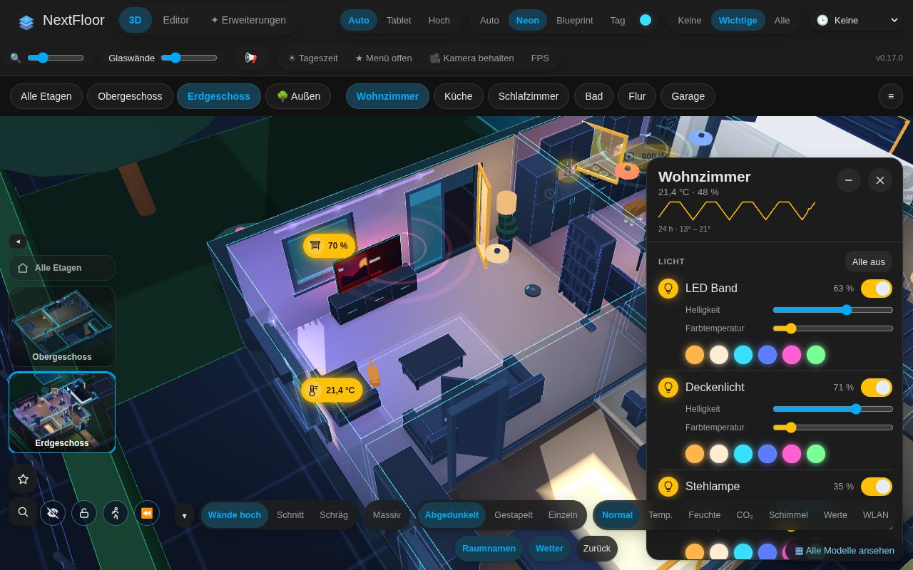</a><br><sub>带面板的实时房间视图</sub></td><td align="center" width="33%"><a href="https://raw.githubusercontent.com/therealMRBK/NextFloor/main/docs/images/editor.jpg">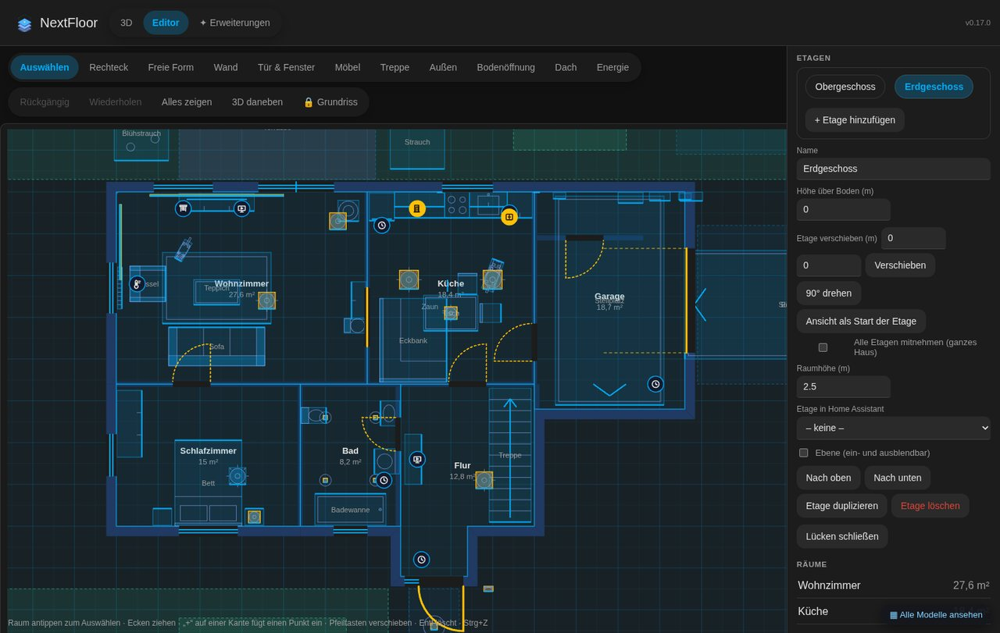</a><br><sub>平面图编辑器与旁边的 3D</sub></td><td align="center" width="33%"><a href="https://raw.githubusercontent.com/therealMRBK/NextFloor/main/docs/images/view-stacked.jpg">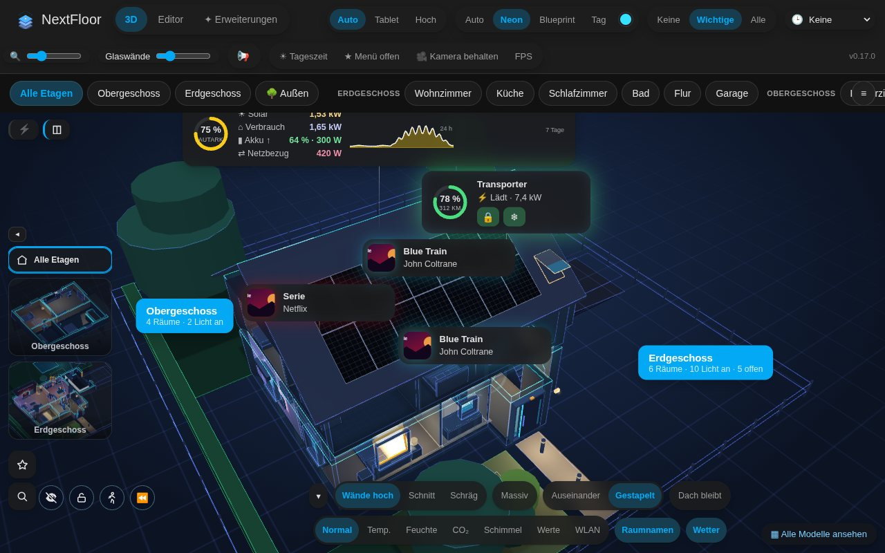</a><br><sub>楼层叠放</sub></td></tr>
<tr><td align="center" width="33%"><a href="https://raw.githubusercontent.com/therealMRBK/NextFloor/main/docs/images/view-energy.jpg">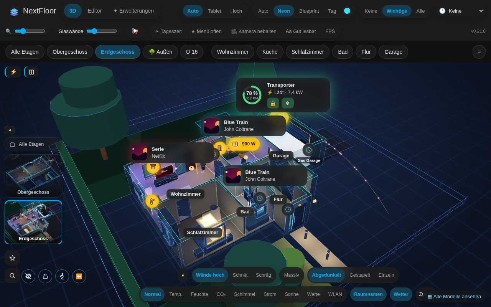</a><br><sub>能量流动</sub></td><td align="center" width="33%"><a href="https://raw.githubusercontent.com/therealMRBK/NextFloor/main/docs/images/view-weather-rain.jpg">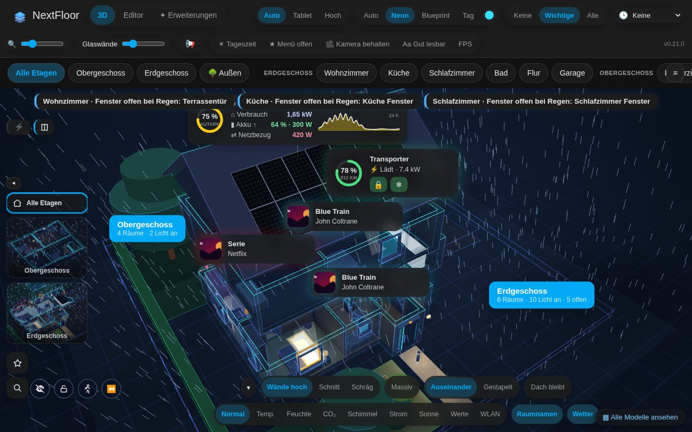</a><br><sub>窗外天气</sub></td><td align="center" width="33%"><a href="https://raw.githubusercontent.com/therealMRBK/NextFloor/main/docs/images/view-media.jpg">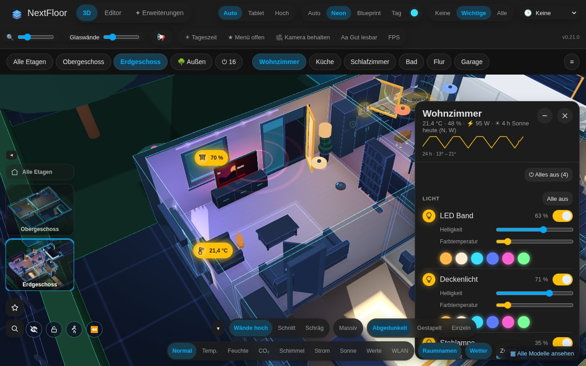</a><br><sub>电视屏幕</sub></td></tr>
<tr><td align="center" width="33%"><a href="https://raw.githubusercontent.com/therealMRBK/NextFloor/main/docs/images/view-heat.jpg">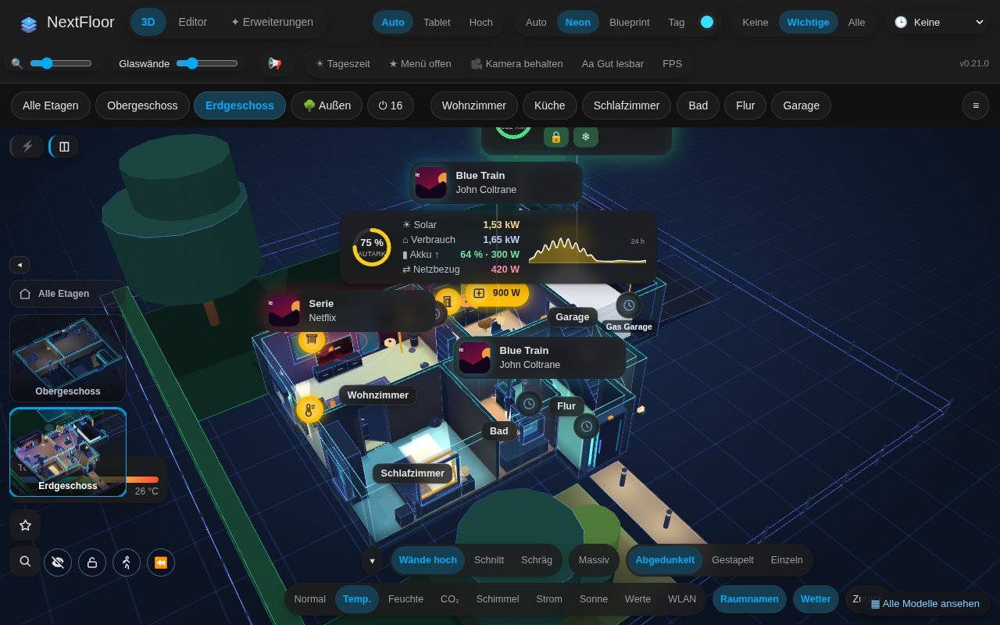</a><br><sub>热图</sub></td><td align="center" width="33%"><a href="https://raw.githubusercontent.com/therealMRBK/NextFloor/main/docs/images/view-cut.jpg">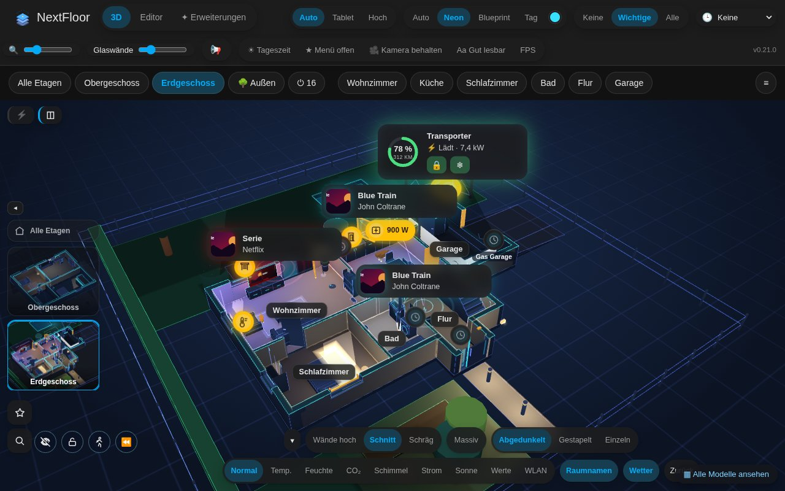</a><br><sub>剖切墙体</sub></td><td align="center" width="33%"><a href="https://raw.githubusercontent.com/therealMRBK/NextFloor/main/docs/images/tablet.jpg">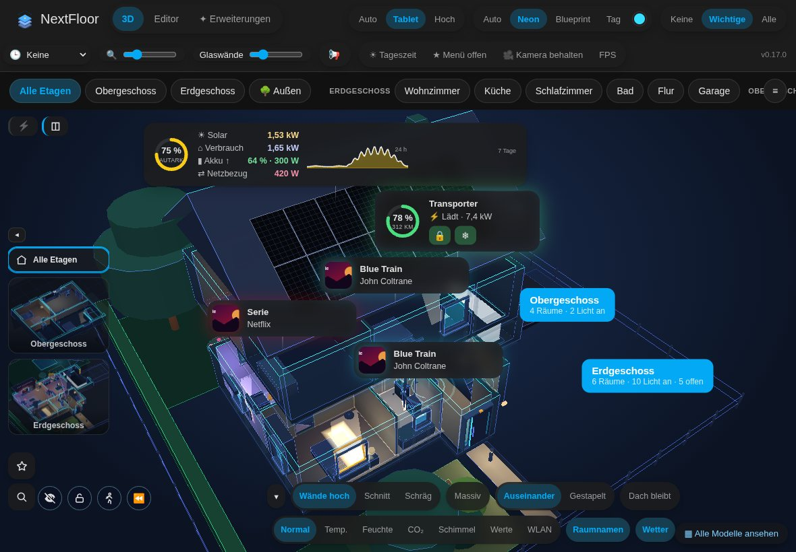</a><br><sub>墙上平板</sub></td></tr>
<tr><td align="center" width="33%"><a href="https://raw.githubusercontent.com/therealMRBK/NextFloor/main/docs/images/editor-furniture.jpg">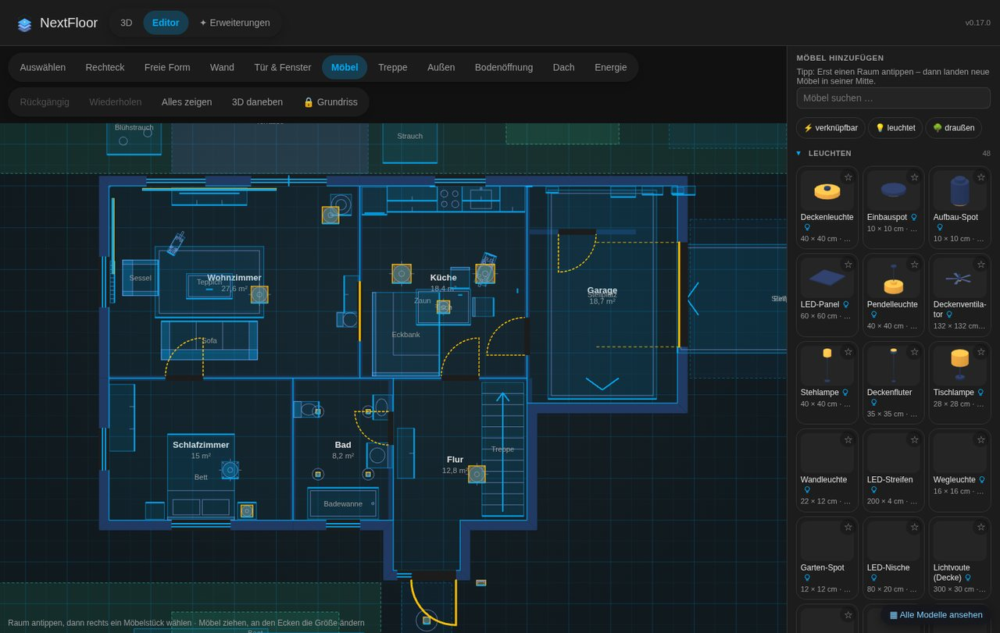</a><br><sub>家具库</sub></td><td align="center" width="33%"><a href="https://raw.githubusercontent.com/therealMRBK/NextFloor/main/docs/images/furniture-ikea.jpg">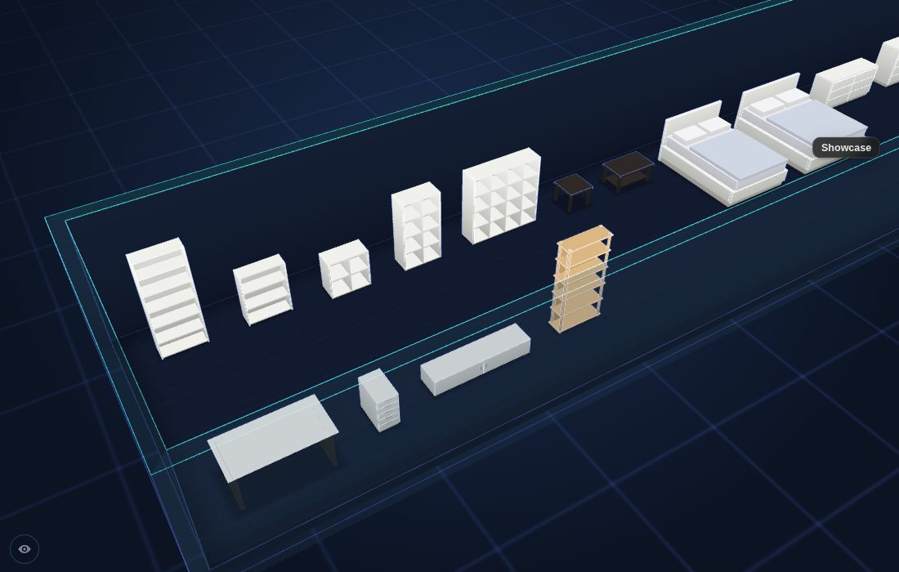</a><br><sub>宜家尺寸</sub></td><td align="center" width="33%"><a href="https://raw.githubusercontent.com/therealMRBK/NextFloor/main/docs/images/vehicles-tesla.jpg">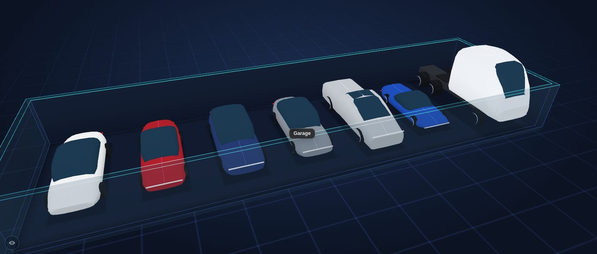</a><br><sub>特斯拉车型</sub></td></tr>
</table>

<table>
<tr><td align="center" width="33%"><a href="https://raw.githubusercontent.com/therealMRBK/NextFloor/main/docs/images/view-room.jpg"></a><br><sub>Neon</sub></td><td align="center" width="33%"><a href="https://raw.githubusercontent.com/therealMRBK/NextFloor/main/docs/images/view-blueprint.jpg">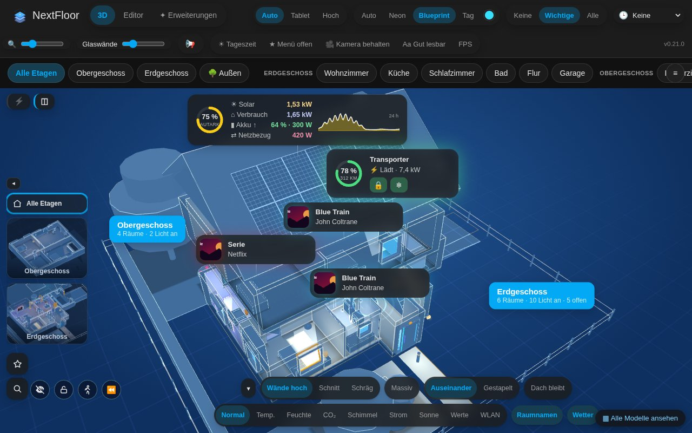</a><br><sub>Blueprint</sub></td><td align="center" width="33%"><a href="https://raw.githubusercontent.com/therealMRBK/NextFloor/main/docs/images/view-day.jpg">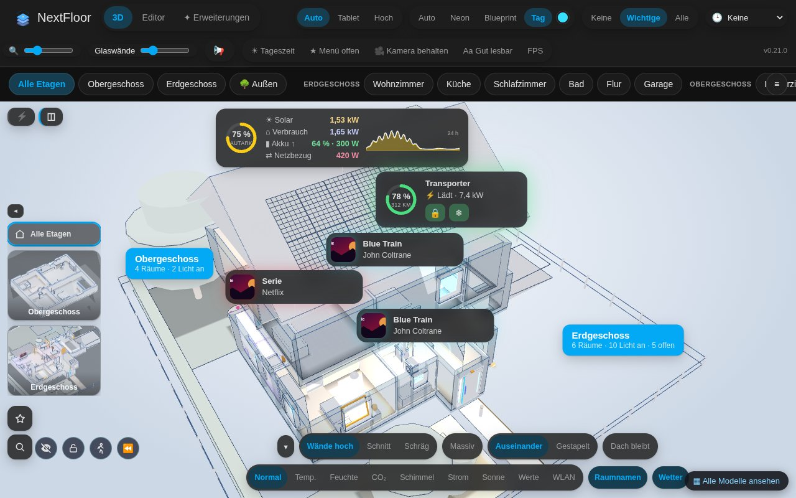</a><br><sub>Day</sub></td></tr>
</table>

## 🚀 安装

**HACS**（推荐）

1. NextFloor 已进入 **HACS 官方商店**：打开 HACS，搜索 **NextFloor** 并下载（或点上面的 HACS 按钮）。
2. 重启 Home Assistant。
3. 添加集成：[](https://my.home-assistant.io/redirect/config_flow_start/?domain=nextfloor)，或 *设置 → 设备与服务 → 添加集成 → NextFloor*。
4. 在侧边栏打开 **NextFloor**，切到**编辑器**，画出你的第一个楼层。

**之前是通过自定义仓库安装的？** 无需任何更改。NextFloor 现已进入 HACS 官方商店，你的安装、平面图和设置保持不变，更新仍通过 HACS 提供。HACS 刷新列表后会自动把它识别为普通仓库。

**手动安装：** 把 `custom_components/nextfloor` 复制到 `config/custom_components/` 并重启。需要 Home Assistant 2025.1 或更高版本。

## 🧩 仪表盘卡片

所有选项都在卡片的可视化编辑器里。YAML 里也一样：

<details>
<summary>全部选项</summary>

```yaml
type: custom:nextfloor-card
floor: floor_ab12cd34   # 可选：只显示某一层（id 来自编辑器）
room: room_ab12cd34     # 可选：从这个房间开始
height: 420             # 可选：高度（像素）
fill: false             # 可选：填满仪表盘标题以下的整屏，而不是固定高度
walls: auto             # 可选：auto | cut
explode: true           # 可选：在房屋视图里把楼层拉开
floor_stack: dim        # 可选：打开某层时下面楼层的处理：dim | stacked | single
quality: auto           # 可选：auto | low | high
theme: neon             # 可选：neon | blueprint | day
accent: "#00e5ff"       # 可选：Neon 外观的强调色
markers: important      # 可选：none | important | all
heatmap: none           # 可选：none | temperature | humidity | co2 | mould | values | wifi
room_panel: true        # 可选：点击房间打开详情
room_names: true        # 可选：3D 里显示房间名
controls: true          # 可选：卡片里的开关，或 wall、floor、temperature、humidity、co2 的列表
floor_thumbs: true      # 可选：用楼层缩略图切换楼层
fullscreen_button: false
stats: false            # 可选：性能显示
alerts: true            # 可选：烟雾、燃气、CO、漏水、报警器，以及下雨时开着的窗，会脉动提示
alert_jump: false       # 可选：出现新告警时跳到对应房间
scenes: true            # 可选：所选房间的场景与脚本按钮
energy: true            # 可选：顶部显示能源数值
flows: true             # 可选：功率流动线常开（true）或常关（false）；留空则显示为开关
holograms: true         # 可选：实时卡片（能量平衡、汽车、媒体）常开或常关；留空则显示为开关
weather: true           # 可选：窗外天气
weather_entity: weather.home   # 可选：用哪个天气实体（默认：按平面图里的设置）
idle_return: 0          # 可选：展示模式，无操作多少秒后回到起始视图
night: "off"            # 可选：展示模式，夜间调暗：off | sun | "22:00-06:00"
idle_orbit: false       # 可选：展示模式，空闲返回后镜头缓慢转动
central_open: false     # 可选：星标菜单（收藏）默认展开，且字号更大
keep_camera: false      # 可选：切换楼层时保持方位、高度和距离
readable: false         # 可选：更高对比度和更大字号（墙上平板）
zoom: 1                 # 可选：0.6 … 2.5，自适应视图的拉近程度
today: true             # 可选：带日程和垃圾桶的「今日」卡片
sensor_bar: true        # 可选：把你自己的传感器显示在顶部
```

</details>

## 📦 使用自己的 3D 模型

有车辆模型（`.glb`）？在 NextFloor 面板里打开**扩展**，选择文件，把车头转向你，选好细节级别，保存到你的 Home Assistant。NextFloor 在浏览器里完成预处理，本身不带任何模型。详见 [docs/models.md](https://github.com/therealMRBK/NextFloor/blob/main/docs/models.md)。

## 🔒 隐私

平面图、图片和家具包都存放在 Home Assistant 的 `.storage` 里。NextFloor 不会自行联网；只有当你打开可选的真实地图时，浏览器才会从瓦片服务器加载地图瓦片（默认是 OpenStreetMap）。图片和历史都来自你自己的 Home Assistant。

## 🤖 由 AI 协助构建

NextFloor 完全在 AI 协助下构建。想法、决策和在真实住宅里的测试来自一个人；设计、代码、测试和文档是与 [Claude](https://www.anthropic.com/claude)（Anthropic）在 [Claude Code](https://www.anthropic.com/claude-code) 里一起写出来的。我更愿意直接说出来，而不是让你去猜。

这对你意味着什么：

- **有测试，但还年轻。** 有自动化测试（前端逻辑、家具包、Home Assistant 后端），每个版本也会在真实浏览器里看、装到真实的 Home Assistant 上，但用户数远少于大多数集成。请预期会有粗糙的地方，并反馈给我们。
- **信任它之前先备份。** 平面图保存在 Home Assistant 的 `.storage` 里；编辑器里有整份平面图的备份与恢复。
- **在意的话就去读代码。** 它是 MIT 许可，体量小到可以通读。欢迎提交 PR，AI 写的也欢迎，只要说明并跑过检查（见 [CONTRIBUTING.md](https://github.com/therealMRBK/NextFloor/blob/main/CONTRIBUTING.md)）。

## 🛠️ 开发

<details>
<summary>构建、测试、预览</summary>

```bash
cd frontend
npm install
npm test            # 纯逻辑测试
npm run typecheck
npm run build       # 把 bundle 写到 custom_components/nextfloor/frontend（需提交）
npm run screenshot  # 用本地 Chrome 或 Chromium 渲染 preview/index.html（虚构的演示数据）
```

- **不装 Home Assistant 也能预览**：用任意本地 Web 服务器打开 `preview/index.html`。
- **部署到测试实例**：创建 `deploy.local.json`，内容为 `{"target": "<config>/custom_components/nextfloor"}`，然后在 `frontend/` 里运行 `npm run deploy`。
- **Python 测试**在 CI 里用 `pytest-homeassistant-custom-component` 运行。
- **家具包**：内置家具包由 `tools/build_packs.py` 生成。自己做的家具包格式见 [docs/packs.md](https://github.com/therealMRBK/NextFloor/blob/main/docs/packs.md)（德语）。

</details>

## 💬 想法、问题与缺陷

想法和问题请到 [Discussions](https://github.com/therealMRBK/NextFloor/discussions)，缺陷请到 [Issues](https://github.com/therealMRBK/NextFloor/issues/new/choose)。

## 🙏 致谢

NextFloor 起初是 Mastershort（Torsten）的 [NeonPlan 3D](https://github.com/Mastershort/neonplan3d) 的一个分支。"在 Home Assistant 里拥有一套实时 3D 的家"这个想法，以及 NextFloor 生长所依赖的基础，都是他的。NextFloor 沿着自己的方向把这个想法继续下去：完全免费、开源，面向所有人。谢谢你，Torsten！

## 许可证

MIT，见 [LICENSE](https://github.com/therealMRBK/NextFloor/blob/main/LICENSE)。NextFloor 包含 [three.js](https://threejs.org)（MIT）、[Lit](https://lit.dev)（BSD-3-Clause）；它们的声明在 [THIRD_PARTY_NOTICES.md](https://github.com/therealMRBK/NextFloor/blob/main/THIRD_PARTY_NOTICES.md) 里。

"Home Assistant" 是其所有者的商标；"Tesla" 及特斯拉车型名称是 Tesla, Inc. 的商标；"IKEA" 及其产品名称是 Inter IKEA Systems B.V. 的商标；此处仅用于说明尺寸和车型。NextFloor 是独立的社区项目，与 Nabu Casa、Tesla 或 IKEA 没有关联，也未获其背书。
